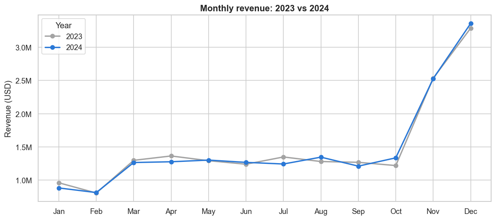
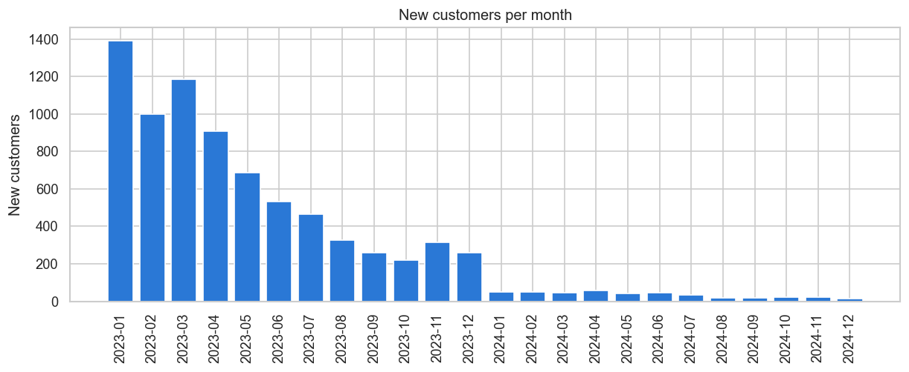
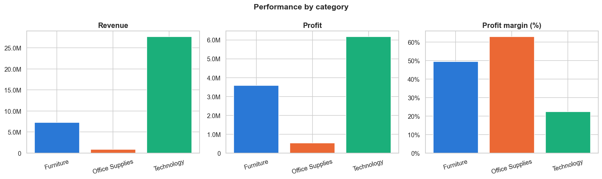
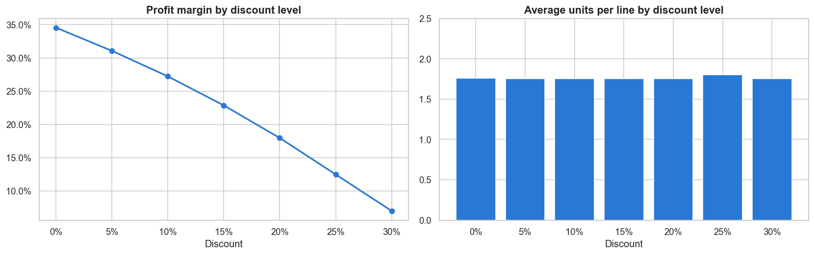

# Sales Data Analysis with Python & SQL

End-to-end data analysis of 2 years of sales (2023-2024) from a fictional US retailer of office supplies, furniture and technology.
The goal is to understand how the business is performing and answer business questions using **Python (pandas, matplotlib, seaborn)** and **SQL (SQLite)**.



## Dataset

- **80,983 rows** (one row = one product inside an order), 27 columns
- 60,000 orders, 7,962 customers, 27 products in 3 categories
- Period: January 2023 - December 2024
- Columns include order and delivery dates, shipping mode, customer segment and location, product, price, cost, discount, sales, profit and return flag

## Project structure

```
├── data/
│   ├── raw/sales.csv              # original data
│   ├── processed/sales_clean.csv  # created by notebook 01
│   └── sales.db                   # SQLite database, created by notebook 01
├── notebooks/
│   ├── 01_data_cleaning.ipynb     # data quality checks and preparation
│   ├── 02_eda.ipynb               # exploratory data analysis with charts
│   └── 03_sql_analysis.ipynb      # 14 business questions answered with SQL
├── sql/
│   └── business_questions.sql     # all the SQL queries in one file
├── images/                        # charts used in this README
└── requirements.txt
```

## What I did

**1. Data cleaning** ([notebook](notebooks/01_data_cleaning.ipynb))
- Checked missing values, data types, duplicates, categorical values and outliers
- Verified that the calculated columns (sales, profit, margin, delivery days) match their formulas
- Removed 68 duplicate rows; found some data issues (unreliable city names, "Same Day" shipping that never ships on the same day)
- Created time columns and split the data into a 4-table SQLite database (`customers`, `products`, `orders`, `order_items`)

**2. Exploratory data analysis** ([notebook](notebooks/02_eda.ipynb))
- KPIs, distributions, sales over time, products, discounts, customers, geography, shipping, returns and correlations

**3. SQL analysis** ([notebook](notebooks/03_sql_analysis.ipynb) | [queries](sql/business_questions.sql))
- 14 business questions using `JOIN`, `GROUP BY` / `HAVING`, `CASE WHEN`, subqueries, CTEs and window functions (`RANK`, `LAG`, `SUM OVER`)

## Key findings

| | |
|---|---|
| Total revenue | 35.7M USD |
| Total profit | 10.3M USD |
| Profit margin | 28.8% |
| Average order value | 596 USD |
| Revenue growth 2024 vs 2023 | -0.4% |

**1. The business is not growing - and almost no new customers were acquired in 2024.**
Revenue, profit, orders and average order value were practically the same in both years. Customers are very loyal (only 2.2% bought once),
but in 2024 the company got only a few dozen new customers per month.



**2. Technology is 77% of the revenue and 60% of the profit**, even with the lowest margin (22%). Office Supplies have the best margin (63%) but are only 2.4% of the revenue.



**3. Discounts reduce profit without increasing sales.** The margin falls from 34.5% (no discount) to 7% (30% off), while the units per line stay the same.
Phones and laptops sold with 30% off are sold at a loss.



**4. Strong seasonality:** November and December are ~33% of the yearly revenue (December sells 2.6x a normal month), in every category.

**5. Customer concentration:** the top 20% customers generate 48% of the revenue; customers with 11+ orders are 23% of customers and 46% of revenue.

**6. Returns:** 6.8% of the lines are returned (2.1M USD). Office Supplies have the highest rate (8%), but 80% of the returned money is Technology.

**7. Operations:** delivery times match the shipping modes, but not one "Same Day" order was shipped on the day it was ordered.

## Recommendations

1. **Limit discounts on laptops and phones** to 15-20% - they don't bring extra volume and 30% off means selling at a loss.
2. **Invest in customer acquisition** - growth depends on new customers, and 2024 had almost none.
3. **Plan stock, logistics and marketing around Q4**, and create campaigns for January/February to soften the drop after the peak.
4. **Protect the top customers** with a loyalty program, since a small group brings almost half of the revenue.
5. **Investigate returns** (Office Supplies rate, Technology value) and **fix the "Same Day" service**.

## How to run

```bash
pip install -r requirements.txt
jupyter notebook
```

Run the notebooks in order (`01` -> `02` -> `03`). Notebook 01 creates the clean CSV and the SQLite database used by the other two.

## Tools

Python 3.13 · pandas · matplotlib · seaborn · SQLite · Jupyter

---
*The dataset is fictional and was used only for learning and portfolio purposes.*
